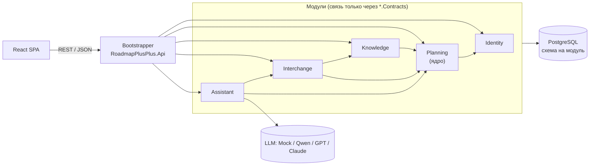

# Архитектура

## Модульный монолит

Систему режем вертикально, по бизнес-модулям, а слои `Domain`, `Application`, `Infrastructure` и `Endpoints` остаются просто папками внутри модуля. Всё это собирается в одно приложение и разворачивается одним контейнером. Почему мы не взяли слоистый монолит или микросервисы, подробно разобрано в [ADR-0002](decisions/0002-modular-monolith.md).

| Модуль | За что отвечает |
|---|---|
| Identity | пользователи, команды, участники и главы, роли команды, приглашения, вход |
| Planning (ядро) | дерево `Item`, видимость узлов по ролям, свои поля и статусы, зависимости, ссылки, расписание, `ChangeSet`, история, а заодно экраны "Сегодня / завтра" и "Сводка" |
| Knowledge | MD-документы у узлов, вложения, полнотекстовый поиск |
| Interchange | каноническая `TaskTable` и адаптеры к ней: Markdown, xlsx/csv, Google Таблицы ([ADR-0001](decisions/0001-task-table-source.md)), "контекст для ИИ", позже iCal |
| Assistant | провайдеры LLM, промпты, сессии, учёт токенов |
| Notifications (позже) | Telegram-бот: задачи на завтра, дедлайны, назначения |



Стрелки на схеме означают зависимости через контракты. Identity нужен вообще всем модулям, но нарисована только его связь с ядром, иначе схема превращается в паутину.

## Правила границ

1. Модуль видит у других модулей только их `*.Contracts`. Всё остальное объявлено `internal`, так что нарушение просто не скомпилируется, а в CI это дополнительно проверяют архитектурные тесты.
2. Писать в дерево может только Planning. Импорт и ИИ лишь предлагают `ChangeSet`, то есть список правок с пометками "из источника" или "додумано", а человек смотрит его и применяет целиком или частично. Один и тот же механизм с одним экраном просмотра обслуживает и MD-импорт, и будущие Google Таблицы, и ассистента.
3. База одна, но у каждого модуля своя схема, свой `DbContext` и свои миграции. JOIN между схемами не делаем, модули ссылаются друг на друга только по Id.
4. Реакции на события вроде "узел удалили, значит архивируем его документы" идут через простую внутрипроцессную шину из `BuildingBlocks`.

## Контракт API

Фронт не описывает запросы руками, типы он берёт из OpenAPI-документа бэкенда. Цепочка такая:

1. `dotnet build` бэкенда пишет документ в [backend/openapi/openapi.json](../backend/openapi/openapi.json), этим занимается пакет `Microsoft.Extensions.ApiDescription.Server`. Документ лежит в git, поэтому любое изменение API видно прямо в диффе PR.
2. `npm run api:generate` во `frontend/` превращает документ в типы `src/shared/api/schema.d.ts` с помощью `openapi-typescript`.
3. Запросы пишутся через клиент `api` из `openapi-fetch`, а путь, параметры и тип ответа проверяет компилятор.

```ts
const item = useQuery({
  queryKey: ['items', itemId],
  queryFn: ({ signal }) => unwrap(api.GET('/api/items/{itemId}', { params: { path: { itemId } }, signal })),
})
```

`unwrap` отдаёт данные, а если пришла ошибка, бросает `HttpError`, в котором есть `status`, `code`, `requestId` и `fieldErrors` из ProblemDetails.

Если вы поменяли эндпоинт, соберите бэкенд, запустите `npm run api:generate` и закоммитьте оба файла. Забыть не получится: CI `backend` упадёт, если документ разошёлся с кодом, а CI `frontend`, если типы разошлись с документом. Чтобы тип ответа вообще попал в документ, эндпоинт должен возвращать `result.ToHttpResult()`, а возможные ошибки объявлять через `.ProducesProblem(404)`.

## Ошибки API

Ожидаемая ошибка у нас не исключение, а `Error` внутри `Result` из `BuildingBlocks`, и эндпоинт превращает её в ответ тем же вызовом `result.ToHttpResult()`. Исключения оставлены для того, что действительно пошло не по плану.

| `Error` | Статус | Пример |
|---|---|---|
| `Validation` | 400 | пустое название, а сами поля перечислены в `errors` |
| `Forbidden` | 403 | нет прав на команду или узел |
| `NotFound` | 404 | узла нет или пользователь его не видит |
| `Conflict` | 409 | узел пытаются перенести внутрь собственного потомка |

Любая ошибка, включая 404 на несуществующий адрес и 500, приходит в формате ProblemDetails (`application/problem+json`):

```json
{
  "status": 404,
  "title": "Not Found",
  "detail": "Узел не найден.",
  "code": "planning.item_not_found",
  "requestId": "0HNP8MNM14SG4:00000001"
}
```

Кроме этих четырёх есть ещё 401: его отдаёт сам сервер, если запрос пришёл без входа, а все эндпоинты под `/api`, кроме health, OpenAPI и входа, требуют входа по умолчанию (подробнее в [ADR-0004](decisions/0004-auth.md)). Слишком частые попытки входа и регистрации получают 429.

По `code` фронт отличает одну ошибку от другой, это стабильный машинный код, а `detail` написан для человека. `requestId` совпадает с заголовком `X-Request-Id`, который есть у любого ответа, и с id запроса в логах, так что ошибку, о которой написал пользователь, легко найти в логе. Если в API случилось необработанное исключение, в лог уходит стек вызовов с этим id, а клиент получает 500; текст самого исключения попадает в `detail` только в режиме Development.

## Стек

Библиотеки пока кандидаты, окончательно выбираем их, когда доходим до конкретной части.

| Слой | Технология | Зачем |
|---|---|---|
| Backend | .NET 10 (LTS), ASP.NET Core, OpenAPI | основной сервер |
| Доступ к данным | EF Core + Npgsql, EFCore.NamingConventions | `DbContext` на модуль, имена в snake_case, JSONB для своих колонок |
| БД | PostgreSQL 17+ | дерево, JSONB, полнотекстовый поиск по базе знаний |
| Markdown на сервере | Markdig (GFM-таблицы, YAML front matter), YamlDotNet | импорт и экспорт |
| ИИ | Microsoft.Extensions.AI (`IChatClient`) | один интерфейс для Mock, OpenAI-совместимых моделей (Qwen, GPT) и Claude |
| Границы модулей | xUnit-тесты: граф ссылок из `.csproj` и публичные типы модулей через reflection; ArchUnitNET подключим, когда понадобятся правила слоёв внутри модуля | архитектурные тесты в CI |
| Realtime (позже) | SignalR | совместное редактирование |
| Frontend | React 19, TypeScript 6, Vite 8, линтер oxlint | SPA |
| Роутинг | React Router (`createBrowserRouter`) | страницы по адресам и глубокие ссылки |
| Данные на фронте | TanStack Query; типы из OpenAPI делает openapi-typescript, клиент openapi-fetch | кэш и типы прямо из контракта |
| UI-кит | свои компоненты на CSS Modules, а для диалога и контекстного меню Radix UI | доступность (фокус, клавиатура, Esc) без своей реализации |
| Таблица задач | TanStack Table | своя таблица, вариант A из ADR-0001 |
| Таймлайн | d3-scale + d3-zoom, своя отрисовка (SVG или Canvas) | плавный зум от года до минут; для быстрого прототипа подойдёт vis-timeline |
| Markdown на фронте | react-markdown + remark-gfm, редактор CodeMirror 6 или Milkdown | просмотр и правка базы знаний |
| Инфраструктура | Docker Compose, Nginx | один `docker compose up`, статика и прокси `/api` |
| Тесты | xUnit v3 на Microsoft.Testing.Platform, Testcontainers (Postgres), Vitest, Playwright | |
| CI | GitHub Actions | сборка и тесты на каждый PR |

Для хостинга хватит слабого VPS: API, Postgres и Nginx укладываются примерно в 1-2 ГБ памяти. Модели на этом сервере не запускаем, ИИ работает через внешний API или через Ollama на чьём-нибудь ПК.
